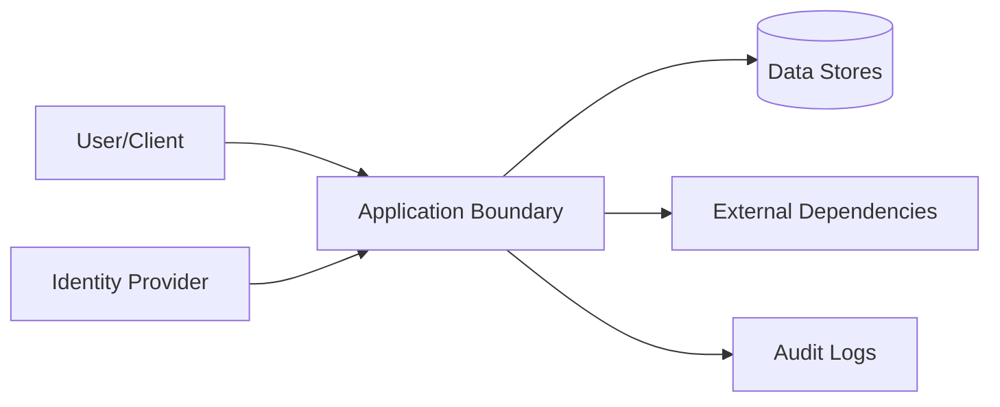

# Security

## Preflight custody and capabilities

Preflight executes only reviewed build/test/release-verification operations. It
must not evaluate arbitrary imported YAML as a local shell program, inherit
publishing credentials into local proof children, or silently install missing
capabilities. Existing process supervision bounds ordinary owned descendants;
it is not a security sandbox against deliberate process-group escape. Unsupported
containment requirements fail explicitly.

Temporary remote transport is restricted to a fresh request-scoped preflight
namespace. It cannot overwrite the work branch or match publishing/deployment
triggers. Its exact remote commit and tree require readback. Credentials remain
with their existing authorized provider or official client; success records
supplied as arbitrary JSON are not authenticated provider evidence. Public API
reads must retain TLS/server custody and exact run/attempt/source binding.

The public reader seals finite GET routes and validates artifact redirects before
following them. Ordinary process/API budgets remain distinct from bounded archive
transfer budgets. ZIP members are verified in memory with explicit size, count,
path, type and expansion limits, never extracted or executed as evidence. A raw
archive handoff gains authority only through fresh provider metadata and digest
verification. Session-health proof stores only its safe active/inactive status,
not session credentials, and cannot self-update the candidate executable.

Historical Decapod-source entrypoint proof is anchored to the published source
lineage and the same immutable commit's package identity, release and literal
template. It does not execute historical Rust or trust a self-declared generated
fingerprint. Unsupported or unverifiable source fails closed; copied files in
an unrelated consumer repository do not activate this source-history path.
Current candidate entrypoints still require the evaluating binary's template.

## Release-only material-spec proof boundary

Release names, labels, and mutable refs cannot authorize the material-spec
exception. The shared proof rejects a staged edit even if the working tree was
reverted, malformed event metadata, a foreign configured-base ancestry, and a
synthetic merge with additional source changes. Exact generated hashes cannot
launder altered authored prose, template payload, configuration, or dependencies.
This proof changes no credential, publication permission, or external grant.

## CI checkout and provider authority

CI must not repair permissive provider checkout modes by recursively changing
existing state or enabling trusted-group access implicitly. Direct governance
checks recreate the exact committed tree in a new privately owned checkout with
umask 077, without copying runtime databases, sharing object-file hard links, or
mutating the source permissions. User-configured trusted datastore groups retain
their existing explicit policy. Source CI requests read-only repository contents
access; release token denials do not authorize broader app grants or publishing.
ARM musl proof uses a pinned official image and direct QEMU user-mode execution,
with no privileged container or host binfmt registration introduced by this lane.

Required immutable CI context is checked before local-only skip paths. A missing
base ref, protected branch, malformed event, or different checkout cannot silently
omit the material-spec gate. Local-only ref transfer preserves provider state.
Scratch projection proof creates private files and directories at creation time;
it never relaxes storage checks or repairs existing user/runtime permissions.

## Integration artifact custody

Parallel integration runners consume only the artifact produced by their own
workflow commit. Preparation dereferences declared test runfiles before transport;
execution uses those relocated files through the existing scratch/process-group
supervisor. Shard IDs select known test groups, never arbitrary shell commands.
An empty or malformed Gatling inventory must fail rather than silently dropping
coverage or invoking the full suite without filters.

## Threat Model

## STRIDE Table
| Threat | Surface | Mitigation | Verification |
|---|---|---|---|
| Spoofing | Auth boundary | strong auth + token validation | auth tests |
| Tampering | State mutation APIs | integrity checks + RBAC | integration tests |
| Repudiation | Critical actions | immutable audit logs | log review |
| Information disclosure | Data at rest/in transit | encryption + classification | security scans |
| Denial of service | Hot paths | rate limit + backpressure | load tests |
| Elevation of privilege | Admin interfaces | least privilege + policy checks | authz tests |

## Authentication
- Identity source:
- Token/session lifetime:
- Rotation and revocation:

## Authorization
- Role model:
- Resource-level policy:
- Privilege escalation controls:

## Governance Artifact Trust Boundaries
- Prompt and issue text is untrusted input; the agent safety gate evaluates it
  before repository instructions are followed.
- Migration ledgers and trajectory files are evidence artifacts, not authority
  to broaden task scope or bypass a human decision gate.
- The migration notice instructs the agent to inspect the ledger; it does not
  silently grant permission to apply an unrequested breaking product change.
- Trajectory hashes protect artifact integrity, while Git history preserves
  prior runs; neither substitutes for authorization or validation.
- Absolute local paths are treated as information-disclosure material at the
  governance-artifact boundary. Internal paths are reduced to project-relative
  names and external paths are replaced with <external-path> before they
  enter trajectory or validation output. This is redaction, not encryption;
  the active filesystem operation retains its private absolute path.
- The data db verify diagnostic has read-only access and no repair authority.
  Corruption cannot grant permission for raw SQLite, REINDEX, or dump/reload;
  recovery is available only through the explicit, authenticated Decapod
  operator command backed by Dactyl v0.11.1's supported contract.
- The local datastore sidecar lock is a coordination primitive, not an
  authorization boundary. Decapod holds it for canonical connection lifetime,
  reports bounded contention, and never deletes it as stale; OS lock release
  handles process exit. External clients that ignore the contract remain
  outside Decapod's corruption-prevention guarantee.

## Data Classification
| Data Class | Examples | Storage Rules | Access Rules |
|---|---|---|---|
| Public | docs, non-sensitive metadata | standard | unrestricted |
| Internal | operational telemetry | controlled | team access |
| Sensitive | tokens, PII, secrets | encrypted | least privilege |

## Sensitive Data Handling
- Encryption at rest:
- Encryption in transit:
- Redaction in logs:
- Retention + deletion policy:

## Supply Chain Security
- Recommended scanners: `cargo audit`, `cargo deny`, `cargo vet`
- Dependency update cadence:
- Signed artifact/provenance strategy:

## Secrets Management
Gatekeeper recognizes literal bearer credentials after header/assignment
delimiters, at the start of quoted or backticked values (with optional leading
whitespace), at the start of line/block comments, and on standalone scheme
lines. The word bearer inside an ordinary sentence is not
itself authentication-scheme syntax. Short values and dictionary words in
explicit credential syntax remain findings; token spelling, entropy, test
filenames, and synthetic-fixture labels do not grant an exemption. Secret
scanning remains line-based and heuristic rather than a complete parser or
dataflow analysis: a value described only in arbitrary prose is outside this
bearer-scheme recognizer. A quoted value beginning with a newline is covered
when the scheme and credential occupy the same subsequent line; concatenated
values or schemes split from their credentials across lines are not covered.

Rust password-value candidates additionally use conservative, byte-span-bound
formatting context. A complete basic named replacement field is excluded from
hardcoded-password findings only when an absolute standard formatting macro
receives that named argument directly from `::std::env::var` with a literal key,
optionally through parentheses and at most one `?` or argument-free `unwrap`
extraction. Further methods could be custom extension traits. This is runtime
source evidence, not an exemption based on the credential's spelling. Every
other match on the same line, including the environment-key literal, is still
scanned. Arguments with literal defaults, unknown calls, or captured-variable
provenance remain findings; a recognized unresolved replacement field receives
a specific diagnostic rather than a safety waiver.

This deliberately partial Rust classifier does not expand macros or resolve
whole-program dataflow. Unqualified macros do not grant exemptions. Opaque
macro bodies, ambiguous standard-library namespaces, transforming attributes,
malformed source, cooked string escapes, unsupported format grammar, BOMs, and
shebangs retain the ordinary findings. Absolute standard paths assume the
standard extern-prelude names; local bindings visible in the scanned file fail
closed. Dependencies or parent modules that redefine those names are outside
this file-local source model. Raw and multiline strings use original byte
locations; a mismatch in source mapping never grants an exemption.

Connection-string, key, and dangerous-pattern rules remain independent. SQL-
looking strings and embedded shell inputs remain findings: a SQL-looking string
can be passed indirectly to a shell, so extensions and nearby keywords cannot
prove it harmless. Synthetic credential-shaped fixtures remain detectable.
Missing container custody and other publication evidence remain independent
blocking requirements.

| Secret | Source | Rotation | Consumer |
|---|---|---|---|
| External service auth material | managed runtime configuration | periodic | runtime services |
| Artifact signing material | managed signing service/local secure store | periodic | release pipeline |

## Security Testing
| Test Type | Cadence | Tooling |
|---|---|---|
| SAST | each PR | language linters/scanners |
| Dependency scan | each PR + weekly | supply-chain tools |
| DAST/pentest | scheduled | external/internal |

## Trust-Boundary Inventory
| Boundary | Principal/Input | Authority Granted | Validation | Audit Evidence | Failure Default |
|---|---|---|---|---|---|
| User/agent -> entrypoint | prompt and issue text | bounded task context | prompt safety gate | trajectory record | deny/reject |
| Entrypoint -> core | parsed command arguments | scoped operation | command contract | validation receipt | deny/reject |
| Core -> persistence | governed state mutation | recorded artifact update | session and invariant gates | audit ledger | rollback/fail closed |
| Runtime -> external dependency | network/package input | explicitly authorized capability | policy and provenance checks | action evidence | timeout/degrade |

## Agent and Automation Safety
- The first local Decapod call in each run must surface any release transition
  and migration instruction before the agent continues.
- Migration notices direct inspection of the migration ledger and catalog; they
  do not silently authorize an unrequested breaking product change.
- Untrusted prompt, issue, configuration, or attachment content cannot broaden
  authority or replace a human decision gate.
- Privileged mutations require a scoped actor and durable proof artifact.

## Compliance and Audit
- Regulatory scope:
- Audit evidence location:
- Exception process:

## Pre-Promotion Security Checklist
- [ ] Threat model updated for changed surfaces.
- [ ] Auth/authz tests pass.
- [ ] Dependency vulnerability scan reviewed.
- [ ] No unresolved critical/high security findings.

## Strongest Security Primitives
Describe the security primitives and security controls implemented in this repository.

## Security Practices
- **Least Privilege**: Ensure minimal access permissions for all subsystems and roles.
- **Input Validation**: Strictly validate all inputs at trust boundaries.
- **Secure Storage**: Encrypt sensitive data at rest and in transit.

<!-- decapod:codebase-attestation:start -->

## Codebase Attestation

- Repository signal fingerprint: `5d93a6f2f7ce7a182c34b6fc41d527ba263489503b349c9c101681331ac623ea`
- Significant implementation surfaces: `.github/` (11 files), `Cargo.lock/` (1 files), `Cargo.toml/` (1 files), `README.md/` (1 files), `assets/` (21 files), `docs/` (1 files), `src/` (176 files), `tests/` (185 files)
- Refreshed from the current codebase by `decapod rpc --op specs.refresh`
<!-- decapod:codebase-attestation:end -->

## Storage filesystem permission boundary

Decapod-owned creation uses explicit Unix directory/file modes before writing
state. Datastore entrypoints validate existing SQLite and coordination
sidecars, leaf links and directory ancestry without silently chmodding an
installation. Explicit trusted-group datastore sharing is bounded to the
storage directory's group; machine credentials and sessions remain private.
Atomic and migration copies use the same owned-state creation boundary.
Online-backup temporaries are confined to a private staging directory before
safe final publication. Published Dactyl 0.11.1 owns private recovery staging
and preserves source owner, group and mode before atomic activation, so the
explicit trusted-group recovery path is supported on Linux and Android under
the constraints below. Unix mode checks are not Windows ACL enforcement. `docs/storage-permissions.md`
defines the supported boundary, operator recovery and subprocess-umask proof.

## Secure shared-directory recovery

The explicit recovery command uses the published Dactyl 0.11.1 primitive.
On Linux and Android it supports an intentionally shared 0660 database beneath
2770 group storage, subject to Decapod's existing opt-in and ancestry policy.
Dactyl confines new rebuild, rollback-journal and retained failure artifacts in
same-filesystem private staging, preserves the original inode in an unused
archive, restores the original owner/group/safe mode on the new inode, and
activates without clobbering a competing destination. Decapod does not chmod
the active database after replacement or change the shared parent directory.

Unsupported platform, ownership and extended-metadata conditions fail closed
with their original typed codes. Capability and conflict refusals remain
distinct from a recovery that ran and failed. Recovery requires all connection,
filesystem-name, content and metadata writers to be quiesced. Process failure
can leave private diagnostics; blocked rollback may leave the preserved original
at its archive path. Operators inspect those paths before resuming. Ordinary
open, read, write and backup never automatically trigger recovery.

## Branch-local governance and shared policy

A work branch cannot initialize or mutate a governance document aliased to the
host checkout by a symlink, shared inode, or direct bind mount. The document
and its advisory lock remain on the branch volume. Container mounts retain the
shared datastore and applied-migration ledger, expose accepted host policy
configuration read-only, and keep tracked governance/specs branch-local.
Datastore approval categories resolve from that host authority even without
host Git metadata. Unresolved base, task, or recovery evidence fails closed.

Build/test cleanup is limited to an atomically created invocation-owned scratch
directory with the original filesystem identity. Replaced roots and unconfirmed
live process groups are preserved; shared build caches and proof artifacts are
outside deletion authority.

### Buildkite-only readiness transport

The same-workspace-branch transport carries no service skip directive; existing
GitHub Actions runs remain independent and cannot supply Buildkite readiness. Buildkite execution archives, native producer identity,
recipe, actual command outcomes and final attempt freshness remain mandatory.
Publication is a non-forced push or exact-tip reuse of the existing local workbranch;
only the matching remote branch may be created on its first publication. A diverged
remote or changed accepted target fails. Validation never creates an auxiliary
branch, rewrites history, or deletes the real workspace branch. Public artifact
GET timeouts receive at most two same-request retries within the original deadline;
authentication, TLS, HTTP, cancellation and integrity failures are never retried
through another route. Previously verified downloads remain in the active collection.
GitHub check links are discovery locators, never authority for successful
Buildkite execution. No service denial permits changing credentials or falling
back to fabricated evidence. Synthetic Git fixtures isolate host authentication
configuration without changing production transport rewrite rejection.

Remote preparation does not require a fresh legacy local validation receipt.
That receipt cannot prove remote success, and its absence or stale trajectory
binding must not force a duplicate local suite. Current plan, claims, trajectory,
checkpoint, material, review, ownership and transport safeguards still apply;
malformed governance remains invalid. Final readiness still requires every
applicable authenticated Buildkite execution and an unchanged candidate/target.

Discovery accepts only the exact reviewed Buildkite host, organization and
pipeline with a positive build number and optional canonical job UUID fragment.
Queries, credentials, foreign hosts and malformed fragments cannot become
network destinations. Cached locators never stand in for execution status or
final freshness. A first ordinary branch push may normalize its all-zero prior
tip only with the provider's explicit created flag, a captured accepted target,
clean exact checkout and ancestry proof; it never becomes PR-readiness evidence.

### Same-branch verification location

Selecting Buildkite moves substantive verification to the required remote workers, preserving local ownership, decision and transport authorization. Public metadata is selected only for the reviewed public repository/profile before requests; a failed authenticated request never silently switches clients. Imported history cannot waive proof: unchanged transports require whole-tree identity, unaccepted historical bases and conflicting targets reject, and current merge checkpoints remain mandatory.

## Reviewed importer compiler and runtime identity

Remote execution custody pins the independently reviewed official Buildkite GHA compiler version and executable digest separately from the runtime executable selected by the authored platform matrix. The reviewed 0.102.3 Linux x86_64 compiler may emit Linux x86_64 or Darwin arm64 runtime plans; a runtime digest never substitutes for the compiler digest. Observed green jobs cannot authorize new versions, executable digests or platforms. A provider upgrade requires independent official-release verification before its exact pins are accepted. Wrong producer, altered artifacts, workflow, matrix or execution identity still fails closed.
